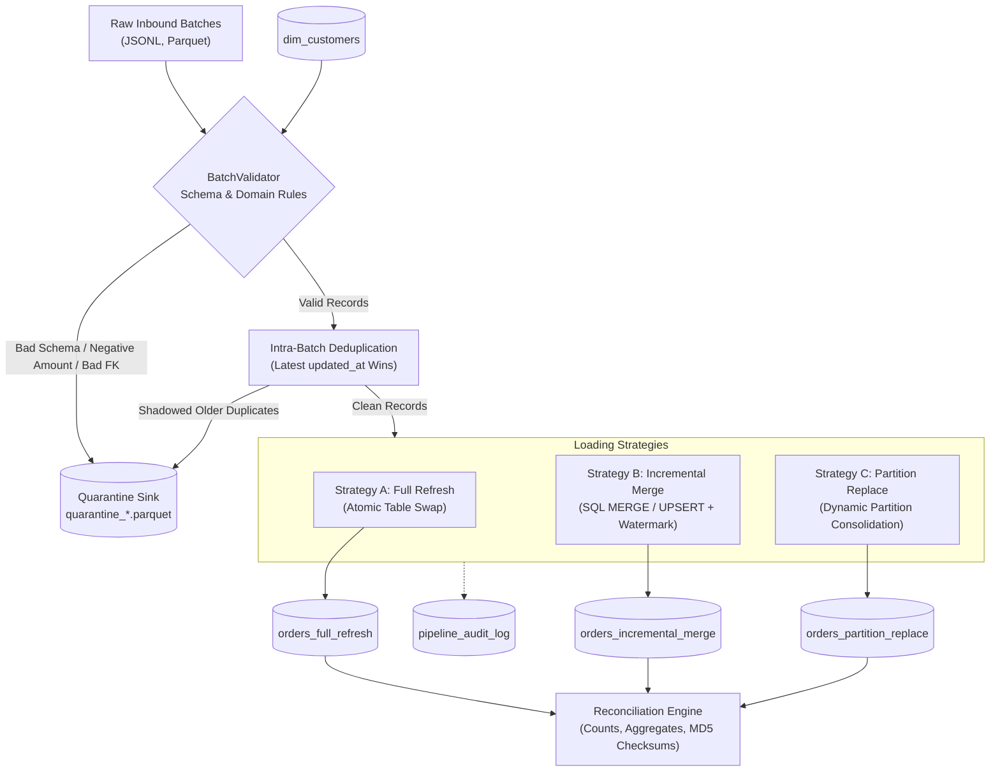

# Ingestion Strategy Benchmark: Full Refresh vs. Incremental Merge vs. Partition Replacement

A production-grade, reproducible Data Engineering reference implementation comparing **Full Refresh**, **Incremental Merge (UPSERT/CDC)**, and **Partition Replacement** on an e-commerce order lifecycle dataset.

The system proves mathematical equivalence across all three loading patterns, handles out-of-order streams and corrupted records, provides comprehensive operational audit logs and quarantine routing, and measures runtime, memory, and failure-recovery trade-offs.

---

## 📋 Table of Contents
1. [Key Features & Objectives](#-key-features--objectives)
2. [Architecture & Workflow](#-architecture--workflow)
3. [Quickstart & Setup Instructions](#-quickstart--setup-instructions)
4. [Running the Pipelines & Demo](#-running-the-pipelines--demo)
5. [Automated Test Suite (19 Passed)](#-automated-test-suite)
6. [Cross-Strategy Equivalence Proof](#-cross-strategy-equivalence-proof)
7. [Empirical Benchmark & Trade-off Analysis](#-empirical-benchmark--trade-off-analysis)
8. [Edge Case & Quarantine Handling](#-edge-case--quarantine-handling)
9. [Idempotency & Failure Recovery](#-idempotency--failure-recovery)
10. [Repository Structure](#-repository-structure)
11. [Data Dictionary Summary](#-data-dictionary-summary)

---

## 🎯 Key Features & Objectives
- **Three Loading Paradigms**:
  1. **Full Refresh (`FullRefreshPipeline`)**: Atomic staging table swap with zero read downtime and automatic drift self-healing.
  2. **Incremental Merge (`IncrementalMergePipeline`)**: ANSI SQL `MERGE INTO` with CDC watermark protection against out-of-order events.
  3. **Partition Replacement (`PartitionReplacementPipeline`)**: Dynamic partition identification and consolidation by `order_date`.
- **Validation & Quarantine Engine**: Pydantic schema validation, domain rule verification (`amount > 0`, `items >= 1`), foreign key checks against `dim_customers`, intra-batch duplicate resolution, and dual Parquet/JSONL quarantine sinks.
- **Automated Equivalence Reconciler**: Compares row counts, primary key sets, financial sums, and deterministic MD5 hashes across sorted table states to guarantee identical output.
- **Operational Observability**: Complete execution audit trail (`pipeline_audit_log`) recording run IDs, timestamps, row counts, quarantined records, and failure reasons.
- **Scalable Synthetic Generator**: Deterministic random generator (seedable) supporting small starter sets up to 100,000+ Parquet records.

---

## 🏛 Architecture & Workflow



---

## 🚀 Quickstart & Setup Instructions

### Prerequisites
- Python 3.10+ (Tested on Python 3.13)
- Windows PowerShell, macOS, or Linux terminal

### 1. Clone & Set Up Virtual Environment
```bash
# Navigate to project directory
cd "d:\yotta_flex_ai project"

# Create virtual environment
python -m venv .venv

# Activate virtual environment
# Windows PowerShell:
.\.venv\Scripts\Activate.ps1
# Linux / macOS:
source .venv/bin/activate

# Install dependencies
pip install -r requirements.txt
```

---

## 💻 Running the Pipelines & Demo

### 1-Click End-to-End Demo
Executes baseline ingestion, incremental updates, quarantine inspection, cross-strategy reconciliation, and performance benchmarks in a single run:
```bash
python run_demo.py
```

### CLI Subcommands (`main.py`)
```bash
# Generate synthetic datasets (includes dimension, baseline, incremental, and edge cases)
python main.py generate --count 1000

# Generate 100,000+ record scalable Parquet dataset
python main.py generate --count 1000 --parquet-100k

# Run performance benchmark suite (e.g. 10k baseline + 2k delta)
python main.py benchmark --initial 10000 --delta 2000

# Run cross-strategy reconciliation report on current database
python main.py reconcile

# View operational audit logs
python main.py audit --limit 10
```

---

## 🧪 Automated Test Suite

The test suite covers happy paths, edge cases, negative scenarios, idempotency, and cross-strategy equivalence:

```bash
pytest -v
```

### Test Coverage Summary:
- `tests/test_validation_and_quarantine.py`:
  - Happy path validation
  - Empty batch handling
  - Malformed unparseable JSON payloads
  - Missing mandatory fields and null constraints
  - Domain constraints: negative and zero amounts (`amount <= 0.0`)
  - Domain constraints: zero or negative items count (`items_count < 1`)
  - Foreign key referential integrity against `dim_customers`
  - Intra-batch duplicate resolution (latest `updated_at` wins, shadowed routed to quarantine)
  - Quarantine file creation and verification of Parquet structure
- `tests/test_full_refresh.py`:
  - Cold baseline table creation
  - Atomic table swap verification
  - Idempotency upon rerun
- `tests/test_incremental_merge.py`:
  - Primary key inserts and updates
  - Soft-delete handling
  - Watermark out-of-order protection (stale event does NOT overwrite newer data)
  - Idempotency upon rerun
- `tests/test_partition_replace.py`:
  - Dynamic partition extraction
  - Partition consolidation
  - Untouched historical partition isolation
  - Idempotency upon rerun
- `tests/test_idempotency_and_recovery.py`:
  - Multi-run idempotency across all three strategies (counts and sums remain identical)
  - Transaction failure rollback (target tables remain intact if load fails)
- `tests/test_equivalence_reconciliation.py`:
  - Multi-batch end-to-end stream asserting 100% mathematical equality and MD5 checksum matches across all three strategies.

---

## 📊 Cross-Strategy Equivalence Proof

The following reconciliation report was generated after applying an initial batch (1,000 orders) followed by an incremental CDC batch (455 records containing inserts, updates, deletes, out-of-order data, and deliberate anomalies):

| Evaluation Metric | Full Refresh | Incremental Merge | Partition Replace | Equivalence Result |
| :--- | :---: | :---: | :---: | :---: |
| **Target Total Rows** | 1,202 | 1,202 | 1,202 | **100% IDENTICAL** |
| **Primary Key Set Equality** | Complete Match | Complete Match | Complete Match | **0 Differences** |
| **Sum Net Amount** | \$957,878.04 | \$957,878.04 | \$957,878.04 | **100% IDENTICAL** |
| **Sum Statutory Tax (18%)** | \$172,417.99 | \$172,417.99 | \$172,417.99 | **100% IDENTICAL** |
| **Sum Total Invoice Amount** | \$1,130,296.03 | \$1,130,296.03 | \$1,130,296.03 | **100% IDENTICAL** |
| **Distinct Customers** | 293 | 293 | 293 | **100% IDENTICAL** |
| **Deterministic MD5 Hash** | `88a445a307dc...` | `88a445a307dc...` | `88a445a307dc...` | **100% MATCH** |

---

## ⚡ Empirical Benchmark & Trade-off Analysis

Measured against 10,000 baseline records and a 2,000-record incremental CDC batch:

### 1. Ingestion Runtime & Memory Trade-off
| Ingestion Phase | Strategy | Records Processed | Duration | Speedup | Peak RAM |
| :--- | :--- | :---: | :---: | :---: | :---: |
| **Cold Baseline** | Full Refresh | 10,000 | 3.45 s | 1.0x | 26.30 MB |
| | Incremental Merge | 10,000 | 3.22 s | 1.07x | 26.27 MB |
| | Partition Replace | 10,000 | 5.01 s | 0.69x | 26.27 MB |
| **Incremental CDC** | Full Refresh | 12,025 (Full History) | 5.70 s | 1.0x (Baseline) | 31.73 MB |
| | **Incremental Merge** | **3,740 (Delta Only)** | **1.99 s** | **2.86x Faster** | **9.84 MB (-69%)** |
| | **Partition Replace** | **3,740 (Delta Only)** | **2.18 s** | **2.61x Faster** | **9.84 MB (-69%)** |

### 2. Measured Optimization: Columnar Projection Pushdown in Parquet
- **Baseline (Full Row Scan `SELECT *`)**: `29.296 ms`
- **Optimized (Columnar Pushdown `SELECT sum, count`)**: `5.494 ms`
- **Measured Speedup**: **5.33x Faster**
- *Reasoning*: Columnar Parquet eliminates decoding and memory buffering of 15 unused columns, streaming only the compressed numeric column directly into vectorized SIMD registers.

---

## 🛡 Edge Case & Quarantine Handling

Any record that violates structural or business rules is diverted to an isolated quarantine sink:
- **Sink Formats**: Apache Parquet (`data/quarantine/quarantine_<run_id>.parquet`) and JSONL.
- **Traceability**: Preserves `record_index`, `raw_payload`, `rejection_rule`, `rejection_reason`, `rejected_at`, `run_id`, and `source_file`.

### Handled Anomaly Types:
1. **Malformed Payloads**: Unparseable JSON strings or corrupt byte sequences (`MALFORMED_JSON`).
2. **Missing Required Fields**: Null or omitted primary keys, dates, or foreign keys (`SCHEMA_OR_DOMAIN_CONSTRAINT`).
3. **Domain Constraint Violations**: Negative amounts (`amount <= 0.0`) or zero items count.
4. **Referential Integrity Failures**: Inbound `customer_id` not found in `dim_customers` (`REFERENTIAL_INTEGRITY_VIOLATION`).
5. **Intra-Batch Duplicates**: Multiple event states for the same `order_id` in a single batch. Sorted by `updated_at DESC`: the newest event is accepted; shadowed duplicates are quarantined (`INTRA_BATCH_SHADOWED_DUPLICATE`).
6. **Out-of-Order Events**: A stale event arriving with an older `updated_at` is safely rejected by the target watermark check, preventing fresher state from being overwritten.

---

## 🔄 Idempotency & Failure Recovery

- **Safe Reruns**: Rerunning the exact same batch $k$ times produces identical row counts, aggregate totals, and MD5 hashes with zero duplicated rows.
- **Transaction Rollback**: Every loading strategy operates within ACID transaction boundaries (`BEGIN TRANSACTION` / `COMMIT`). If an unexpected crash occurs mid-execution:
  - DuckDB automatically triggers a `ROLLBACK`.
  - Target tables remain in their prior clean state.
  - The pipeline logs the failure and stack trace to `pipeline_audit_log` with `status = 'FAILED'`.

---

## 📂 Repository Structure

```
d:\yotta_flex_ai project\
├── config/
│   └── settings.py               # Paths, constants, table names, tax rate
├── src/
│   ├── schemas/                  # Pydantic models & DuckDB SQL DDL
│   │   ├── customer.py           # dim_customers schema
│   │   └── order.py              # orders schema, columns, derived calculations
│   ├── generator/                # Scalable synthetic dataset generator
│   │   └── data_generator.py     # Generates baseline, CDC, edge-case, and 100k Parquet sets
│   ├── validator/                # Validation engine & quarantine manager
│   │   └── validator.py          # Enforces schemas, business rules, dedup, and quarantine
│   ├── pipelines/                # The 3 Core Ingestion Strategies
│   │   ├── base.py               # BasePipeline contract, metrics, lineage
│   │   ├── full_refresh.py       # Strategy 1: Atomic Table Swap Full Refresh
│   │   ├── incremental_merge.py  # Strategy 2: SQL MERGE / UPSERT with Watermark
│   │   └── partition_replace.py  # Strategy 3: Dynamic Partition Consolidation
│   ├── audit/                    # Operational logging & metrics
│   │   └── audit_logger.py       # pipeline_audit_log tracking & tabular summaries
│   ├── reconciliation/           # Cross-strategy integrity verification
│   │   └── reconciler.py         # Row counts, aggregates, key sets, MD5 hashes
│   └── benchmark/                # Performance & optimization profiler
│       └── benchmark_runner.py   # Measures runtime, memory, throughput, and pushdown
├── tests/                        # Automated Pytest Suite (19 tests)
│   ├── conftest.py               # Fixtures & mock setups
│   ├── test_validation_and_quarantine.py
│   ├── test_full_refresh.py
│   ├── test_incremental_merge.py
│   ├── test_partition_replace.py
│   ├── test_idempotency_and_recovery.py
│   └── test_equivalence_reconciliation.py
├── docs/                         # In-depth technical documentation
│   ├── data_dictionary.md        # Comprehensive data dictionary
│   ├── architecture.md           # Architecture flow & Mermaid diagrams
│   └── trade_off_analysis.md     # Detailed trade-off analysis & benchmark matrix
├── data/                         # Data storage
│   ├── raw/                      # Synthetic input files (JSONL & 100k Parquet)
│   ├── quarantine/               # Quarantined bad records (.parquet & .jsonl)
│   └── targets/                  # DuckDB warehouse storage (analytics_warehouse.duckdb)
├── reports/                      # Generated reconciliation & benchmark reports
├── main.py                       # Modular CLI tool
├── run_demo.py                   # 1-Click end-to-end execution script
├── requirements.txt              # Production dependencies
└── pyproject.toml                # Project metadata & pytest configuration
```

---

## 📖 Data Dictionary Summary

| Column Name | SQL Type | Domain / Constraints | Description / Business Rule |
| :--- | :--- | :--- | :--- |
| `order_id` | `VARCHAR` | Primary Key, Non-empty | Unique deterministic order business key (`ORD-YYYYMMDD-XXXXXX`). |
| `customer_id` | `VARCHAR` | FK -> `dim_customers` | Purchasing customer; must exist in dimension table. |
| `order_date` | `DATE` | `YYYY-MM-DD` | Order calendar date; partition key. |
| `order_timestamp` | `TIMESTAMP`| ISO-8601 UTC | Timestamp when the order was placed. |
| `order_status` | `VARCHAR` | Enum | `PENDING`, `CONFIRMED`, `SHIPPED`, `DELIVERED`, `CANCELLED`, `REFUNDED`. |
| `payment_method` | `VARCHAR` | Enum | `CREDIT_CARD`, `DEBIT_CARD`, `UPI`, `NET_BANKING`, `CRYPTO`. |
| `currency` | `VARCHAR` | 3-char code | Transaction currency (`USD`). |
| `amount` | `DOUBLE` | `amount > 0.0` | Order subtotal; strictly positive. |
| `tax_amount` | `DOUBLE` | Derived | Statutory tax calculated as `ROUND(amount * 0.18, 2)`. |
| `total_amount` | `DOUBLE` | Derived | Total invoice amount calculated as `ROUND(amount + tax_amount, 2)`. |
| `items_count` | `INTEGER` | `items_count >= 1` | Quantity of merchandise items in order. |
| `updated_at` | `TIMESTAMP`| ISO-8601 UTC | CDC mutation watermark timestamp; prevents out-of-order overwrites. |
| `is_deleted` | `BOOLEAN` | Default `FALSE` | Soft-delete tombstone indicator for audit preservation. |
| `run_id` | `VARCHAR` | Lineage metadata | Unique execution run ID that published this row. |
| `source_file` | `VARCHAR` | Lineage metadata | Provenance source file or stream origin. |
| `ingested_at` | `TIMESTAMP`| System metadata | Ingestion host timestamp. |

*(For full details, see [data_dictionary.md](file:///d:/yotta_flex_ai%20project/docs/data_dictionary.md).)*
